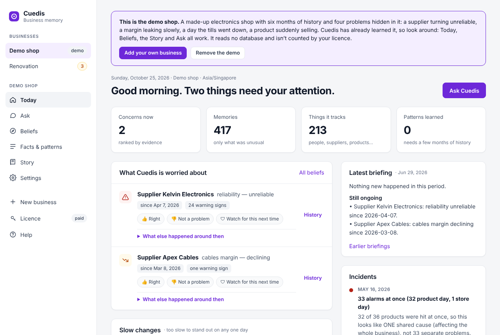
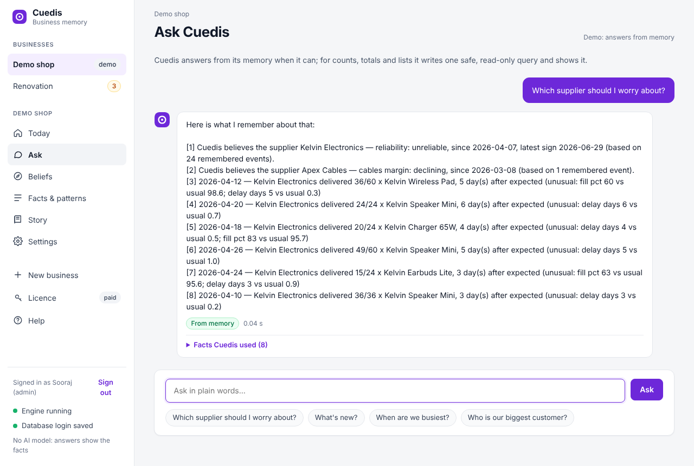
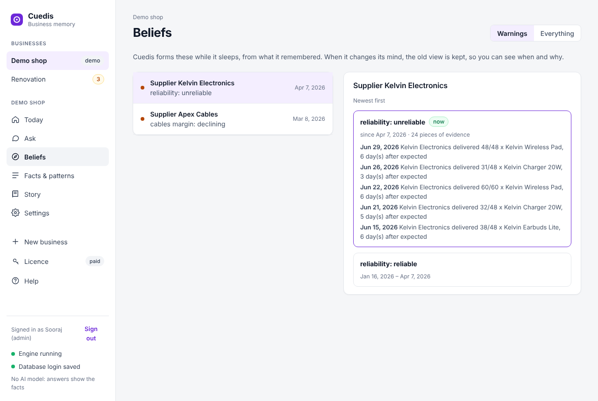

  

<h1 align="center">Cuedis</h1>

<b>Your business has a memory.</b> 
Your database already knows what's going wrong. Cuedis tells you.

  <a href="https://cuedis.com#download"><b>Download free</b></a> ·
  <a href="https://cuedis.com/guide">User guide</a> ·
  <a href="https://cuedis.com#pricing">Pricing</a>

---

Cuedis sits beside the database your business already runs on (**MySQL or SQL Server**): your POS, ERP, accounting,
job or order system. It reads new records every few minutes, learns what is normal for every customer, supplier,
product, staff member and job, and tells you when something changes:

- **a briefing every morning** on Telegram,
- **an alert straight away** for anything you asked it to watch,
- **answers in plain words** whenever you ask, on Telegram or in the app.

It runs on **your own computer**. It only ever reads your data, never changes it, and nothing is sent to a cloud.

## What is Cuedis?

It works like your best long-time employee. Someone who has worked with you for years doesn't read every receipt;
they just *notice* when something's off. Cuedis is built to remember your business the same way:

| | |
|---|---|
| **It notices what matters** | Every new record is compared with what's normal for that supplier, customer, product or person. Routine stays in your database; the unusual is remembered. |
| **It sleeps on it** | Every night it goes over the day: repeated signs become a belief (“Kelvin has been unreliable since 7 April”), things that keep happening become known patterns. |
| **It changes its mind, and remembers why** | When things improve the belief changes, and the old one is kept with its evidence. |
| **It sees one cause behind many alarms** | Thirty products dropping on the same day is one problem, not thirty. |
| **It notices slow trouble** | A margin losing a little every week never alarms on any single day. Cuedis watches the trend. |

You don't need to know what to ask. Cuedis has already noticed.

## What it found by itself

No programming per business: Cuedis studies the database, drafts its own setup and asks a few questions about what it
can't work out. In our tests:

- **A retail shop:** a supplier turning unreliable, a margin on cables leaking slowly, the day the tills went down.
- **A renovation contractor:** one technician padding add-on works (S$43,000), bathroom jobs overrunning, plywood creeping up about 1% a week.
- **An online gift shop** (a million order lines): two huge order-then-cancel events, a price entered wrongly.
- **A manufacturer and distributor:** every sale below cost matched a real clearance promotion.

It works wherever the data is in MySQL or SQL Server: shops and chains, F&B, wholesale, manufacturing, contractors,
e-commerce, pharmacies, clinics, logistics, workshops, hotels, property, education, gyms, salons and more.

## Features

- **Ask anything** in plain words: answered from memory, or with a read-only query that's shown with the answer.
- **Your own reports:** bring the SQL queries and stored procedures you already use; Cuedis answers with them and can watch them every night.
- **Teams with their own rules** (“cashiers can't see purchase prices”), enforced by Cuedis in briefings, answers and the app.
- **The story:** month by month, what started and ended, ready to hand over.
- **AI agents:** Claude, ChatGPT or Cursor on your office laptops can ask Cuedis (MCP), each limited to its team.
- **Private by default:** personal details (phone, IC, addresses) are never read unless you switch them on; the AI runs on the same PC.

  
  

## Get started

1. **[Get your free key and the download](https://cuedis.com#download)** (Windows/Mac).
2. Run the installer on a computer that can reach your database. No admin rights needed.
3. Make the admin account, activate your key, then add your business, or open the built-in **demo shop** first.

**Free:** one database, your own briefing and chat on Telegram.
**Paid:** more databases, staff teams, group chats, the app on every office computer, AI agents and the API.
**Cloud:** hosted for you; [ask for a quote](https://cuedis.com#cloud).

## Questions

- **Does it change my data?** No. It needs a login that can only read, and refuses one that can write.
- **Does my data leave the building?** No. Cuedis and its AI model run on your computer; Telegram only carries the briefing text you choose to send.
- **Which databases?** MySQL and SQL Server (2008 and later).
- **Is the source code here?** This page is for information and downloads; Cuedis itself is commercial software.

<a href="https://cuedis.com">cuedis.com</a> · <a href="https://cuedis.com/guide">User guide</a>

